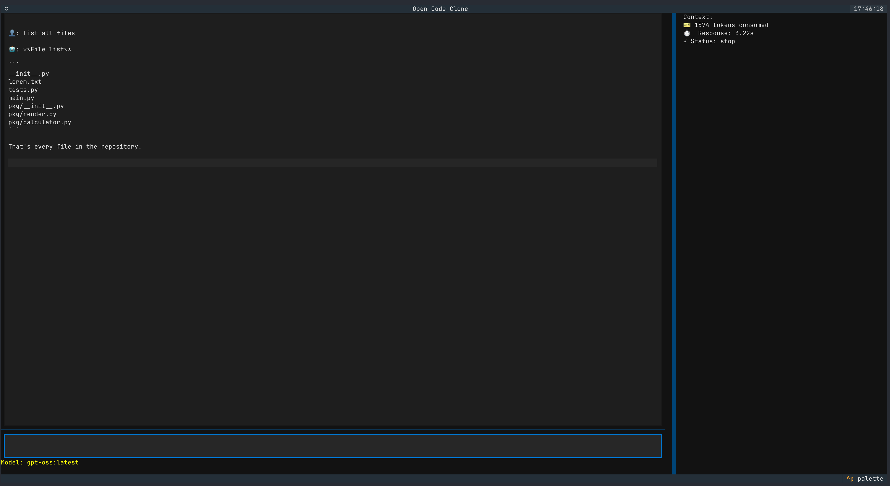

# AI Coding Agent

A terminal-based AI coding assistant that can autonomously analyze and modify
code using local LLMs via Ollama.

## Features

- 🤖 Interactive TUI chat interface
- 🔧 Autonomous tool calling (read files, list directories, write files)
- 📊 Real-time token and performance metrics

## Demo



## Installation

### Prerequisites

- Python 3.10+
- [uv](https://github.com/astral-sh/uv)
- [Ollama](https://docs.ollama.com/) installed and running

### Setup

```bash
# Clone repository
git clone https://github.com/divakarpatil51/open-code-agent-clone.git
cd open-code-agent-clone

# Install dependencies
uv sync

# Start ollama
ollama serve

# Pull a model
ollama pull <model_name>

# Set up environment
export MODEL=<your_model>

# Run
make run-app 
```

### Example Queries

- "List all Python files in the directory"
- "Read app.py and explain what it does"
- "Create a new function to handle user input"

## Limitations

- Only works with local Ollama models
- Limited to file system operations
- Context window constraints

## Future Improvements

- [ ] Add web search capability
- [ ] Support for multiple programming languages
- [ ] Code review mode
- [ ] Git integration
- [ ] Test generation

## Acknowledgments

- Built with Textual
- Powered by Ollama
